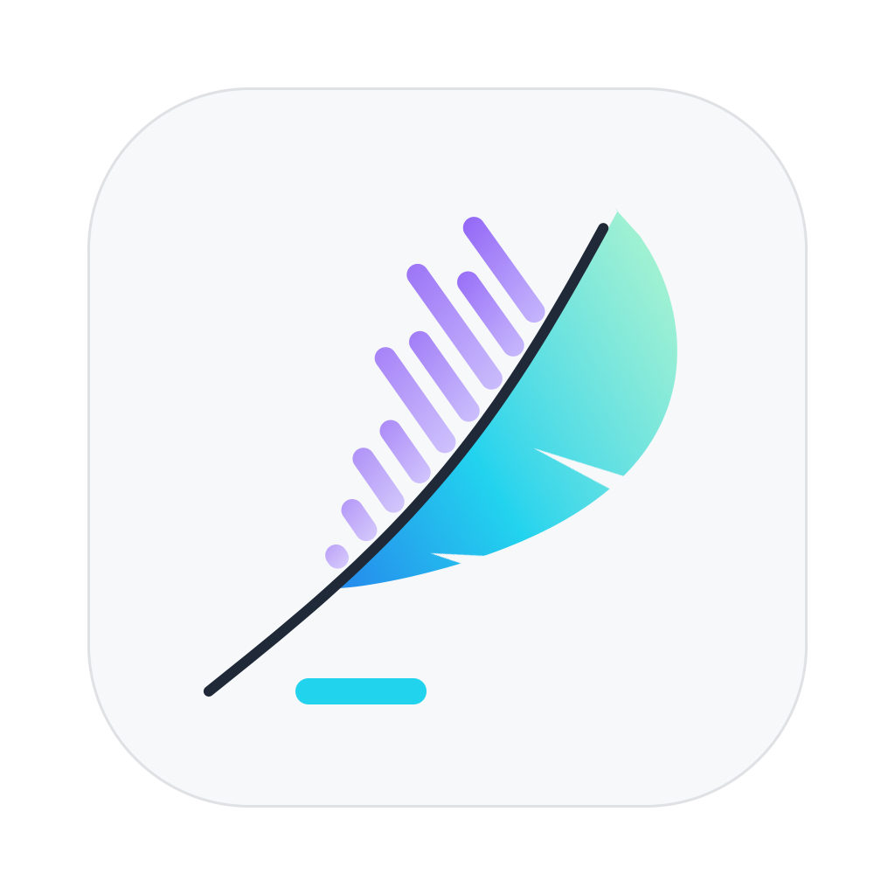
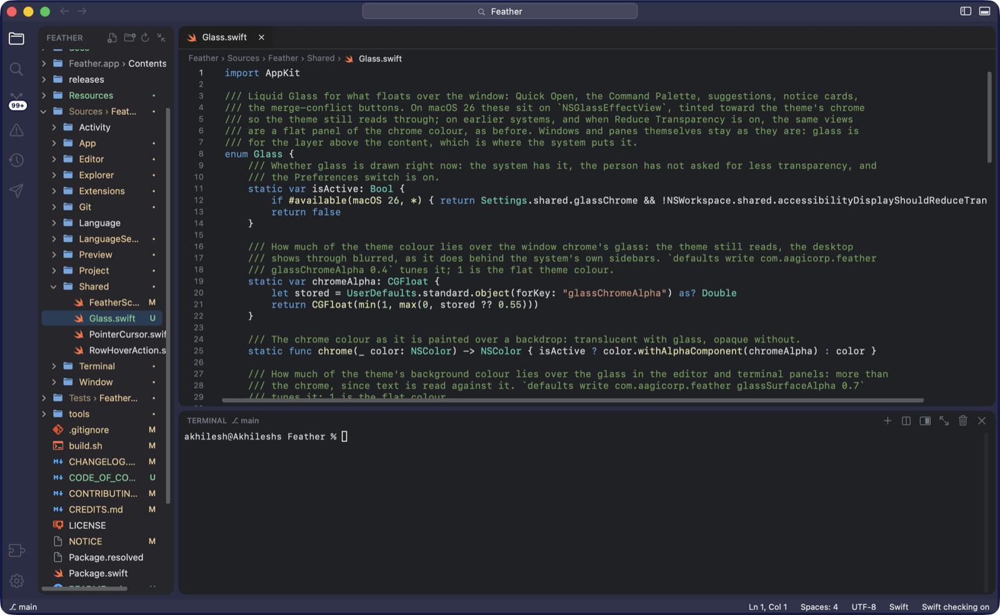
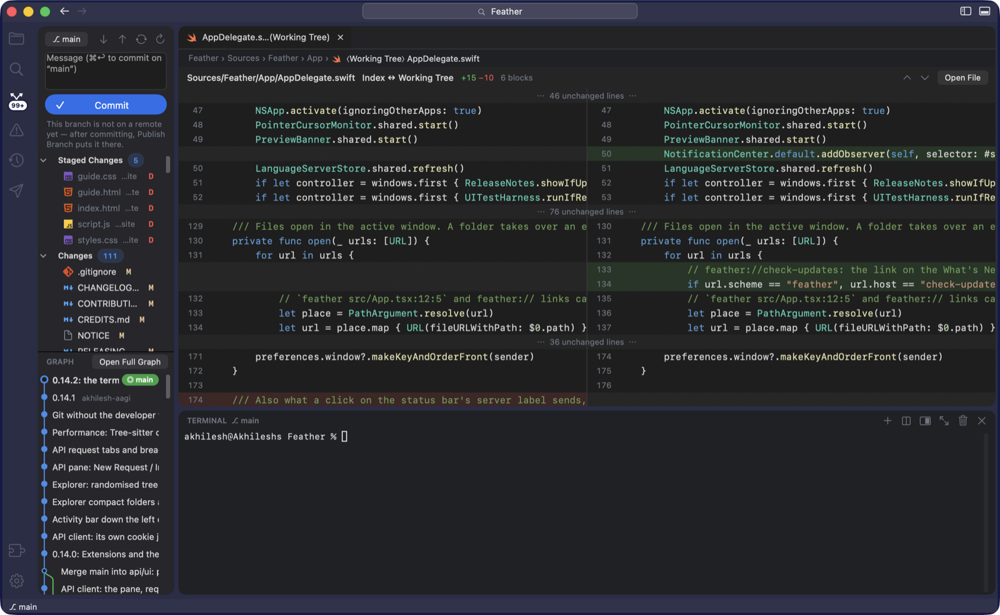
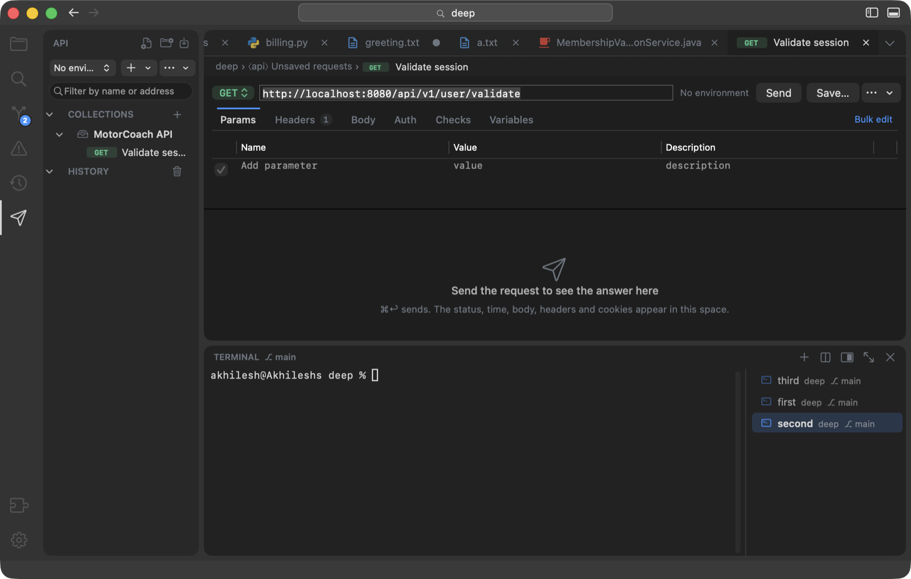

<p align="center">
  
</p>

<h1 align="center">Feather</h1>

<p align="center">
  A native macOS code editor, written in Swift and AppKit, built to stay light.
</p>

<p align="center">
  <a href="LICENSE"></a>
  
  <a href="https://github.com/aagicorp/feather/releases/latest"></a>
  <a href="https://github.com/aagicorp/feather/actions/workflows/ci.yml"></a>
</p>

<p align="center">
  
</p>

Feather opens a folder and gives you an editor, a terminal, source control and a place to run the AI assistant you
already use, in one app that launches fast and stays out of the way. Everything is AppKit; there is no web view
around the editor and no bundled runtime. The 0.14.3 disk image is 7.4 MB.

## Highlights

- **Editor.** Tabs and split editors, code folding, sticky scroll, multiple cursors, a breadcrumb bar,
  `.editorconfig`, auto save, and syntax highlighting from [Tree-sitter](https://tree-sitter.github.io) for
  JavaScript, TypeScript and TSX, Python, Java, Dart, Kotlin, Swift, JSON, CSS, HTML, YAML, Bash, Go and Rust.
  Markdown, web and media files preview beside the code. VS Code colour themes import as they are.
- **Language servers you already have.** Feather talks to the servers installed on your Mac
  (`typescript-language-server`, `pyright`, `jdtls`, `sourcekit-lsp`, `gopls`, `rust-analyzer`) for completion,
  go to definition, hover, rename and formatting, with format on save. Without a server, the project's own
  compilers and linters feed the **Problems** pane, and a built-in symbol finder drives the outline and
  workspace symbol search.
- **Source control without the terminal.** Git marks in the explorer; a Source Control pane laid out like VS
  Code's with init, publish, commit, sync and pull; merge conflicts resolved in the editor with Accept Current,
  Incoming or Both; blame, diffs and a commit graph.
- **Terminal.** A panel on [SwiftTerm](https://github.com/migueldeicaza/SwiftTerm) with a list of terminals,
  splits, drag to reorder, clickable paths and links, and an optional notice when a long command finishes or
  asks a question.
- **AI assistants, kept at arm's length.** One click starts Claude Code, Codex, Gemini CLI, aider, Cursor Agent
  or opencode in a terminal. Feather never calls an AI service itself. The **Activity** pane shows what the
  assistant changed since a checkpoint, hunk by hunk, with revert.
- **Requests.** A built-in API client: collections and environments as plain JSON under `.feather/api`, Postman
  v2.1 and `.http` import and export, cURL paste and ⌘-click from the terminal, OpenAPI import, checks and
  secret variables in the Keychain. See [docs/api-client.md](docs/api-client.md).
- **At home on the Mac.** Liquid Glass window chrome on macOS 26 with floating panels, a colour per project,
  Command Palette, Quick Open, a `feather` command for the shell, and a Reduce Transparency fallback. Folder
  trust: an untrusted folder opens in Restricted Mode, where nothing runs until you say so.
- **Updates.** Signed [Sparkle](https://sparkle-project.org) updates, checked once a day; a release that fixes a
  serious bug can be marked required. Hold Shift at launch for a clean window; **Feather ▸ Reset Feather…**
  wipes settings and caches, never projects.
- **Measured.** `tools/perf.sh` times launch, idle CPU and memory, a 3,000-file folder, a 1.5 MB file and the
  cost of a keystroke on every release build. For 0.14.3 on the machine that made it, the release build idled at
  0.3 % of a core with 93 MB and a project and terminal open. Tree-sitter parsing is capped at 1 MB per file so a
  huge file costs no more than a plain one.

<p align="center">
  
  
</p>

## Install

Feather runs on macOS 13 Ventura or later, on Apple silicon and Intel Macs.

1. Download `Feather.dmg` from the [latest release](https://github.com/aagicorp/feather/releases/latest).
2. Open it and drag Feather to Applications.
3. Open a folder: **File ▸ Open…**, drop it on the Dock icon, or `feather .` after
   **Feather ▸ Install 'feather' Command…**.

Released copies check for updates once a day and under **Feather ▸ Check for Updates…**; updates are signed with
an EdDSA key and verified against the public key inside the app.


## Build from source

You need Xcode 16 or later (the package's tools version is 5.9; CI builds on GitHub's `macos-15` runner).

```sh
git clone https://github.com/aagicorp/feather.git
cd feather
./build.sh                # Feather.app in this folder: ad-hoc signed, never looks for updates
open Feather.app
```

```sh
swift test --parallel     # about 990 unit tests; the parts that need no window
tools/uitest.sh           # window-level checks: opens a real window, drives it, writes PNGs
tools/perf.sh             # measures the release build (launch, idle, big folder, big file, keystrokes)
./build.sh --release      # universal binary with the update feed; needs FEED_URL and the key in release.config
```

`./build.sh --team` makes a universal binary without an update feed, for handing to people directly. Signing,
notarizing and publishing are in [RELEASING.md](RELEASING.md).

## Project layout

| Path | What is in it |
| --- | --- |
| `Sources/Feather/` | The app, one folder per area: `App`, `Window`, `Editor`, `Explorer`, `Language`, `LanguageServer`, `Git`, `Terminal`, `Preview`, `Activity`, `Project`, `Extensions`, `Shared` |
| `Tests/FeatherTests/` | XCTest cases, mirroring the source folders ([README](Tests/FeatherTests/README.md)) |
| `Resources/` | App icon, file icons, Tree-sitter highlight queries, the DMG background |
| `tools/` | `uitest.sh`, `perf.sh`, `update-lab.sh`, the DMG and icon makers, release helpers |
| `docs/` | User documentation kept with the code, and the README's screenshots |
| `build.sh`, `release.sh`, `release.config` | Building the app, shipping a release, and the settings both read |
| `CHANGELOG.md` | Release notes; the app shows the top section as **What's New** |

## Documentation

- Website and user guide: [feather.aagicorp.com](https://feather.aagicorp.com/)
- [API client](docs/api-client.md)
- [What's new](CHANGELOG.md)
- [Releasing](RELEASING.md), for maintainers

## Contributing

Bug reports with steps to reproduce, language support and performance work with before-and-after numbers help
most. [CONTRIBUTING.md](CONTRIBUTING.md) covers the build, the tests, the window harness, the changelog
convention and the code style. Everyone taking part is expected to follow the [code of
conduct](CODE_OF_CONDUCT.md).

## Security

Please report vulnerabilities privately, not in a public issue. [SECURITY.md](SECURITY.md) says how.

## License

Feather is licensed under the [Apache License 2.0](LICENSE). The [NOTICE](NOTICE) file carries the attribution
that the licence asks derivative works to keep. "Feather" and the Feather logo are marks of Aatvaas Granger
Internationals Inc and are not covered by the licence.

## Credits

Feather ships with SwiftTerm, Sparkle, the Tree-sitter runtime and grammars, and the Material Icon Theme's file
icons. [CREDITS.md](CREDITS.md) lists each with its licence; the full licence texts are in
[THIRD-PARTY-LICENSES.txt](THIRD-PARTY-LICENSES.txt).
